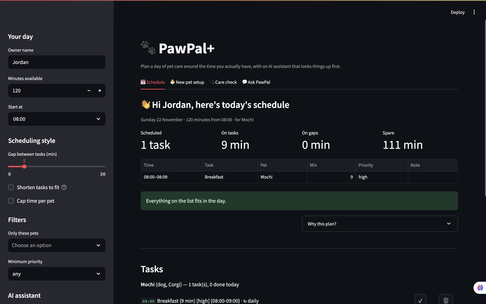
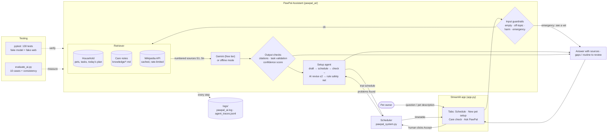
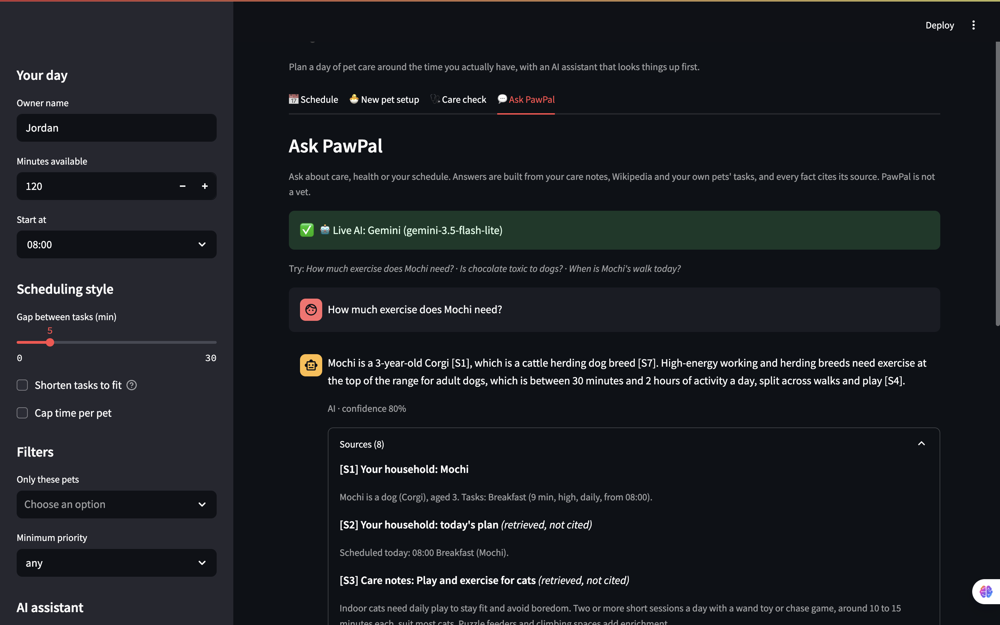
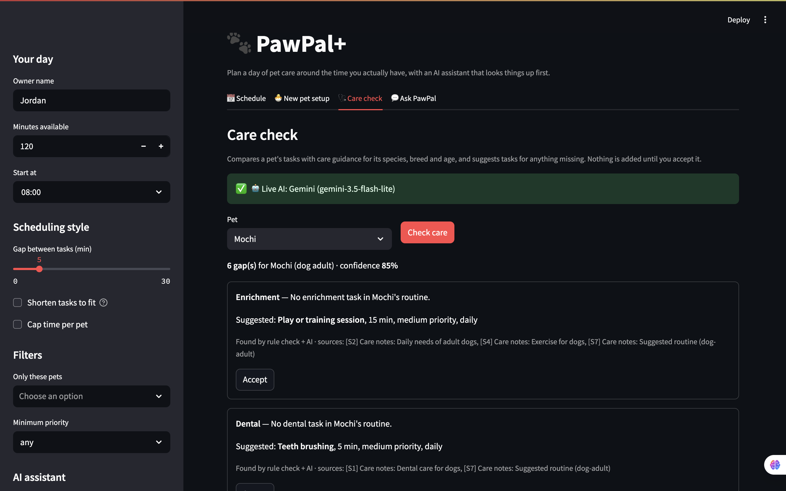
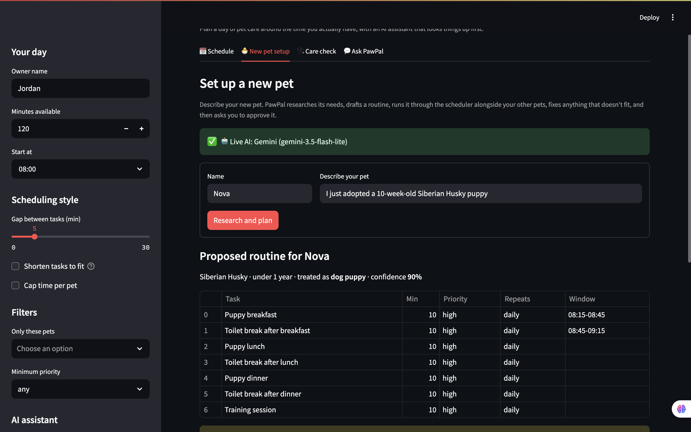

# 🐾 PawPal+ with PawPal Assistant

**A pet-care planner that schedules your day around the time you actually have, plus an
AI assistant that looks things up before it gives advice, and checks its own work before
changing your schedule.**

New pet owners rarely know which care tasks to plan, and busy owners miss gaps in their
routine. PawPal+ answers care questions using your care notes, Wikipedia and your own pets'
tasks, with a source for every claim. It finds what's missing from a pet's routine and
builds a full starting routine for a new pet that genuinely fits your day. Nothing the AI
suggests reaches your schedule until you accept it.

## Original project

This builds on **PawPal+ (Module 2)**, a Streamlit app that planned a day of pet care
across several pets. Its scheduler fits tasks into the owner's available minutes by
priority and time windows, handles daily, weekly and every-N-days recurrence, warns about
clashes and over-commitment, and explains what it left out and why. The full scheduler
documentation is in [docs/scheduler.md](docs/scheduler.md).

## What the AI adds

The app now has four tabs. The original planner is the **Schedule** tab, now laid out
schedule-first and greeting the owner by name.



| Tab | You do | The AI does | AI technique |
|---|---|---|---|
| 🐣 **New pet setup** | "I just adopted a 10-week-old Siberian Husky puppy" | Researches the breed and life stage, drafts a routine, **runs the real scheduler** with your other pets, finds problems (tasks that don't fit, clashes, other pets' tasks pushed out), revises up to twice, and shows what it changed. You accept or discard. | Agentic workflow (plan → act → check → revise) |
| 🩺 **Care check** | Pick a pet | Compares its tasks with guidance for its species, breed and age, and lists gaps, each with a suggested task and its sources. One click adds a task. | RAG + rule check |
| 💬 **Ask PawPal** | Ask a care, health or schedule question | Retrieves from three sources, then answers **only from them**, citing `[S1]`-style source ids. Emergencies get "call a vet now" without the model. | RAG with multiple sources |

The AI changes how the system behaves: accepted suggestions become real `CareTask`s, and the
existing `Scheduler` plans them alongside everything else.

## Architecture overview




How a request flows:

1. **Input guardrails** (`pawpal_ai/safety.py`) reject empty, very long or off-topic input,
   refuse requests to harm an animal, and route emergencies ("my dog ate chocolate",
   seizures, vomiting blood) straight to "contact a vet now" without calling the model.
2. **Retriever** (`pawpal_ai/retrieval.py`) gathers numbered passages from three sources:
   - **Household**: your pets, their tasks and today's generated plan.
   - **Care notes**: `knowledge/*.md`, short editable notes searched with TF-IDF.
   - **Wikipedia**: the free public API, cached, rate-limited, with a 5-second timeout.
3. **Model** (`pawpal_ai/llm.py`): Google Gemini on the free tier, or **offline mode** when
   no key is set. Offline mode quotes the best-matching source sentences, so the app always
   works.
4. **Output checks**: citations to sources that don't exist are removed, and an answer with no
   valid citations is replaced by the sources themselves. Every task the AI proposes is
   validated (minutes, priority, repeat rule, time window, no duplicates, and no medicines or
   doses). Each result gets a 0–1 confidence score.
5. **Setup agent** (`pawpal_ai/advisor.py`): drafts tasks, schedules them on a *copy* of your
   household with the real `Scheduler`, checks the result, and revises.
6. **Human approval**: suggestions only change your schedule when you press **Accept**.
7. **Logging**: `logs/pawpal_ai.log` records every retrieval, answer, fallback and error.
   `logs/agent_traces.jsonl` records each setup agent step.
8. **Testing**: `pytest` (fake model, fake web) and `evaluate_ai.py` check the AI's behaviour.

## Setup

Requires **Python 3.11+** (the `google-genai` package needs it). Check with
`python3 --version`. On a Mac, the built-in `python3` may be 3.9; if so, create the
environment with a newer Python (for example from python.org or Anaconda).

```bash
git clone <this repo> && cd applied-ai-system-project-pawpal
python -m venv .venv
source .venv/bin/activate          # Windows: .venv\Scripts\activate
pip install -r requirements.txt
```

**Turn on the AI model (free, optional):**

1. Go to [aistudio.google.com/apikey](https://aistudio.google.com/apikey), sign in with a
   Google account and click **Create API key**. No credit card is needed.
2. Copy `.env.example` to `.env` and paste your key after `GEMINI_API_KEY=`. `.env` is
   git-ignored, so the key never reaches GitHub.
3. Check that it works:

   ```bash
   python -m pawpal_ai.check
   ```

   ```
   AI model : OK - Gemini (gemini-3.8-flash) replied 'ready'
   Web      : OK - Wikipedia returned 'Siberian Husky'
   ```

   If it says the model isn't available, set `PAWPAL_MODEL` in `.env` to a Flash model that
   AI Studio lists as free for your account.

**Without a key** everything still runs in **offline mode**. The app shows a blue
"Offline mode" banner, and answers are quoted directly from the retrieved sources instead
of being written by the model. That's expected, not a bug.

**Run it:**

```bash
streamlit run app.py         # the app, at http://localhost:8501
python -m pytest             # 130 automated tests, no key or internet needed
python evaluate_ai.py        # reliability report (add --web, or --live with a key)
python main.py               # terminal demo of the original scheduler
```

**If something goes wrong:**

| Problem | Fix |
|---|---|
| `python3 -m pawpal_ai.check` says *google-genai is not installed*, but you installed it | Your terminal's `python3` is a different Python from the one you installed into (common on Macs). Activate the project environment first (`source .venv/bin/activate`) and use `python` inside it. |
| `pip install` fails while building **cryptography** (seen on Intel Macs) | The newest release has no ready-made build for Intel Macs. Create the environment from a Python that already has it, such as Anaconda, and reuse its packages: `~/anaconda3/bin/python3 -m venv --system-site-packages .venv`, then `pip install -r requirements.txt`. |
| The check says **404 NOT_FOUND** for the model | That model has been retired for your account. Set `PAWPAL_MODEL` in `.env` to a current Flash model from AI Studio. |
| The check or app says **503 UNAVAILABLE / high demand**, or answers are slow | Google's free tier is busy. Try a lighter model, `PAWPAL_MODEL=gemini-3.5-flash-lite` (the one used for the live results in this README), or wait and retry. The app never freezes: each request gives up after 45 seconds (with one retry), then falls back to offline answers. |
| **429** errors | You've hit the free-tier rate limit. Wait a minute. |
| Wikipedia results are missing | The web source is optional; the app keeps answering from the care notes. If it says it was rate-limited, it retries after a one-minute cool-down. |

## Sample interactions

All examples are real outputs from the current code. The household is Mochi the Corgi
(3 years, a 30-minute morning walk and a breakfast), 120 minutes available, with 5-minute
gaps between tasks.

### Live mode (Gemini `gemini-3.5-flash-lite`, Wikipedia on)

The screenshots under each example come from a separate run in the app, where Mochi had
only a breakfast task, so their wording differs slightly from the text above them.

**1. Ask PawPal: the answer combines all three sources**

> **You:** How much exercise does Mochi need?
>
> **PawPal:** Mochi is a 3-year-old Corgi [S1], which is a herding breed [S7] and a
> high-energy working type needing exercise at the higher end of the scale [S4]. Mochi's
> schedule includes a daily 30-minute morning walk [S1].
>
> Please note:
> - How much exercise a dog needs depends mostly on breed, age, and health [S4].
> - Avoid hard exercise straight after a large meal; resting for about an hour after
>   eating is a common precaution [S4].
> - If you have any health worries about Mochi, please contact a vet.
>
> *Sources: [S1] Your household: Mochi · [S4] Care notes: Exercise for dogs ·
> [S7] Wikipedia: Pembroke Welsh Corgi · confidence 80%*

The breed fact comes from Wikipedia, the exercise guidance from the care notes, and the
30-minute walk from Mochi's own schedule. Each citation was checked against the sources
that were actually retrieved.



**2. Care check: the AI agrees with the rule check, adds reasons, and finds a gap it missed**

| Found by | Area | Gap | Suggested task | Sources |
|---|---|---|---|---|
| rules + AI | Exercise | Mochi gets 30 min a day; as a herding breed, more activity is suggested | Evening walk, 20 min, daily | Exercise for dogs; **Wikipedia: Welsh Corgi**; Suggested routine |
| rules + AI | Grooming | No grooming task. As a Corgi, Mochi is a double-coated breed that sheds heavily and benefits from frequent brushing | Brushing coat, 10 min, weekly | Grooming dogs; **Wikipedia: Welsh Corgi**; Suggested routine |
| rules + AI | Dental | No dental task | Teeth brushing, 5 min, daily | Dental care for dogs; Suggested routine |
| rules + AI | Enrichment | No enrichment task | Play or training session, 15 min, daily | Daily needs of adult dogs; Exercise for dogs |
| rules + AI | Parasites | No parasite prevention task | Flea and tick prevention, every 30 days | Suggested routine |
| **AI only** | Feeding | **Mochi's routine is missing a second daily meal** | Dinner, 10 min, high, daily | Daily needs of adult dogs; Suggested routine |

Confidence 85%. The rule check alone counted "Breakfast" as covering feeding and missed
the second meal. The model read the care note ("most adult dogs do well on two meals a
day") and caught it. This is the clearest case where retrieval plus a model beat the rules.



**3. New pet setup: "I just adopted a 10-week-old Siberian Husky puppy"**

```
parse     Understood: Siberian Husky, stage dog puppy            (parsed by the AI)
research  Retrieved 7 source(s)                                  (incl. Wikipedia: Siberian Husky)
draft     Drafted 8 task(s) (ai)
check     2 problem(s)        <- Mochi's walk pushed out; one puppy task didn't fit
revise    Round 1: AI revised the routine  -> check: 1 problem(s)
revise    Round 2: AI revised the routine  -> check: 1 problem(s)
revise    Safety net: rule-based fixes after the AI's rounds
check     No problems found
result    7 task(s) proposed, 0 unresolved problem(s)
```

The proposed routine keeps three meals and three toilet breaks (with time windows), plus a
training session. To fit around Mochi, every task was shortened to 5–6 minutes and
handling practice was dropped; the app lists each of these changes before you accept.
The model couldn't make it fit on its own; the deterministic safety net did.



### Offline mode (no API key, Wikipedia off)

**4. Ask PawPal: a health question**

> **You:** Mochi keeps scratching her ear
>
> **PawPal:** Here is what your sources say:
> - Frequent scratching, licking or chewing at the skin can come from fleas, allergies, skin infections or ear problems. [S3]
> - Head shaking and scratching at one ear can point to an ear infection or ear mites. [S3]
>
> ℹ️ PawPal is not a vet and this is not a diagnosis. If you are worried about your pet's health, contact your vet.
>
> *Sources: [S3] Care notes: Itching and scratching · confidence 87%*

**5. Ask PawPal: an emergency (guardrail, model never called)**

> **You:** My dog just ate a bar of chocolate
>
> 🚨 **PawPal:** This sounds like it could be an emergency. Please contact your vet or an
> emergency animal clinic right now rather than waiting for advice here. If your pet may
> have eaten something poisonous, keep the packaging and call a vet or a pet poison
> helpline. Do not make your pet vomit unless a vet tells you to.

**6. Care check: Mochi**

| Area | Gap found | Suggested task | Sources |
|---|---|---|---|
| Exercise | Mochi gets 30 min of exercise a day; about 50 min is suggested for an adult dog | Evening walk, 20 min, medium, daily | Exercise for dogs; Suggested routine |
| Dental | No dental task | Teeth brushing, 5 min, medium, daily | Dental care for dogs; Suggested routine |
| Grooming | No grooming task | Brushing coat, 10 min, low, weekly (Sun) | Grooming dogs; Suggested routine |
| Enrichment | No enrichment task | Play or training session, 15 min, medium, daily | Exercise for dogs; Suggested routine |
| Parasites | No parasite prevention task | Flea and tick prevention, 5 min, high, every 30 days | Suggested routine |

**7. New pet setup: "I just adopted a 10-week-old Siberian Husky puppy" (agent trace)**

```
parse    Understood: Siberian Husky, stage dog puppy
research Retrieved 6 source(s)
draft    Drafted 8 task(s) (template)
schedule Ran the scheduler: 7 slot(s) for the day
check    3 problem(s)                     <- the draft did not fit around Mochi's tasks
revise   Round 1: rule-based fixes
schedule Ran the scheduler: 7 slot(s) for the day
check    No problems found
changes  dropped Short gentle walk (15 min) to fit your time; dropped Socialisation and
         play (15 min) to fit your time; dropped Handling practice (5 min) to fit your time
result   5 task(s) proposed, 0 unresolved problem(s)
```

The proposed routine keeps the three puppy meals (with time windows), a toilet break and a
training session. The app shows the dropped tasks in a yellow box with a tip to raise
*Minutes available* and plan again.

## Design decisions

- **Retrieval before generation, and citations that are checked.** A pet-care app that
  makes things up is worse than none, so the model only sees numbered sources and must cite
  them. Citations are verified in code, not trusted. *Trade-off:* answers are narrower than
  a free-form chatbot, and say "the sources don't answer that" more often.
- **Rules as a safety net under the AI.** The care-gap check and the setup fixes have a
  deterministic, rule-based version. In live mode the AI can reword or add source-backed
  gaps, but a gap found by the rules is never silently dropped. *Trade-off:* more code to
  maintain, but the app is useful and testable without a model.
- **The agent uses the real scheduler as its tool.** Rather than asking the model whether a
  routine fits, the agent schedules it on a copy of the household and reads the result.
  *Trade-off:* the agent can only fix what the scheduler can detect (time, clashes,
  displacement), not care quality.
- **Free and keyless by default.** Gemini's free tier, Wikipedia's public API and stdlib
  TF-IDF keep the cost at zero and the setup to one `pip install`. *Trade-off:* free-tier
  limits and model availability can change, so the model name is a setting and every
  model failure falls back to offline mode.
- **Emergencies bypass the model entirely.** Speed and certainty matter more than
  eloquence there. *Trade-off:* keyword matching can over-trigger (it's tuned so "Is
  chocolate toxic?" is a normal question but "my dog ate chocolate" is an emergency).
- **Human in the loop for every schedule change.** Accept buttons, a preview of the whole
  day, and a visible list of anything the agent dropped or shortened.

## Testing summary

- **130 automated tests pass** (`python -m pytest`): the 49 original scheduler tests, 75 AI
  tests and 6 headless app tests. The AI tests use a scripted fake model and a fake
  Wikipedia, so they run without a key or internet. They cover:
  - retrieval ranking, caching and each source failing on its own
  - every guardrail
  - removal of invented citations
  - a model answer with no citations being replaced
  - a model outage falling back to offline mode
  - bad JSON from the model
  - the agent revising an over-full routine
  - an accepted routine being planned by the real scheduler
- **Evaluation harness** (`python evaluate_ai.py`): **10/10 cases passed, average confidence
  0.73** offline, and the same with real Wikipedia (`--web`). The cases include an
  emergency, an off-topic request, empty input, a simulated web outage, and a consistency
  check (the same question twice gives the same sources: 100% word overlap offline).
- **What didn't work at first:**
  - Wikipedia returned **HTTP 429 (rate limited)** after a burst of test queries. Added
    caching, one request per second, and a 60-second cool-down after a 429.
  - The care check cited "Dental care" as the source for a **grooming** gap, because that
    note mentions brushing teeth. Fixed by preferring notes whose heading matches.
  - "Huskies" didn't match "husky" until the stemmer handled `-ies`.
  - My own first test, "3 month old domesti shorthair", was refused as off-topic (no
    word like "cat" in it). The setup tab now skips the off-topic check, and that input
    is a test.
- **Live mode with real Gemini** (`python evaluate_ai.py --live`, `gemini-3.5-flash-lite`):
  **9/10 → 9/10 → 10/10, average confidence 0.70 → 0.73 → 0.77** across three runs. Both
  failures were the new-pet setup agent pushing another pet's walk out of the day. The
  first was fixed by telling the model when the day starts and what's already booked. The
  second was fixed by a rule-based safety net that shortens essential tasks when the AI's
  own revisions still don't fit. The saved trace shows that on the passing run it was
  the safety net, not the model, that made the routine fit. The lesson: the AI handled
  messy input well, but the hardest constraint needed a deterministic check behind it.

## Reflection

I expected the hard part to be getting the AI to give good answers. Calling the model
turned out to be a few lines of code. The real work was everything around it: choosing
what the model is allowed to see, checking what it says before trusting it, and deciding
what the app should do when the model, the web or the person typing doesn't behave.

The model and the rules turned out to be good at different things. Gemini understood
"7 moth old chuwawa" as a Chihuahua puppy, where my keyword rules would have given up,
and it spotted that Mochi had breakfast but no dinner, which my rule check missed. But
when a new puppy's routine had to fit around another pet's walk, the model failed two
live runs in a row, and a few lines of plain rules fixed it. The best results came from
using both, with a check at the end that doesn't trust either one.

The other lesson was about testing. All my automated tests passed, and the app still
broke the first time I used it myself, because I typed "domesti shorthair" and the
off-topic filter had never seen anything that messy. Real input is untidy in ways tests
don't imagine, so I now see trying the app as a real user, and reading the logs and
traces when something fails, as part of testing rather than an extra.

The responsible-AI reflection (limitations, misuse, AI collaboration) is in
[model_card.md](model_card.md).

## Project layout

```
app.py                 Streamlit app (4 tabs)
pawpal_system.py       Original scheduler: Owner, Pet, CareTask, Scheduler
pawpal_ai/             AI assistant: retrieval, safety, routines, advisor (agent), llm, trace
knowledge/             Editable care notes + routine templates the AI retrieves from
evaluate_ai.py         Reliability report
tests/                 test_pawpal.py (scheduler), test_ai.py, test_app.py
diagrams/              architecture.mmd (system), uml_final.mmd (classes)
assets/                Screenshots used in this README
docs/scheduler.md      Original scheduler documentation
docs/agent_traces_sample.jsonl   Committed sample runs of the setup agent (logs/ is git-ignored)
ai_interactions.md     Agent reasoning traces and how the project was built with AI
model_card.md          Limitations, misuse, testing surprises, AI collaboration
requirements.txt       Python packages
.env.example           Template for your .env (Gemini key and optional settings)
```
